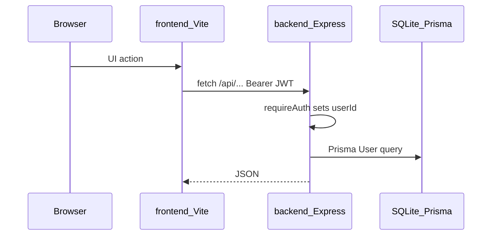

# Architecture

Hub: [docs/README.md](../README.md).

Monorepo: Express API (`backend/`) + Vite React SPA (`frontend/`). SQLite via Prisma. **Baseline:** `User`, nested `Category` tree (empty until the user creates them), tags, user-scoped `Account` (allow-listed types), `CashTransaction` ledger, internal `CashTransfer`, CSV import (presets, dedup, description rules), and statistics. Product backlog: [mvp/CHECKLIST.md](../../mvp/CHECKLIST.md).

Local development: Vite (`:5173`) + API (`:4000`). Production Docker: one Express process serves `/api` and the Vite `dist` (SPA fallback for non-API routes).

## Request flow

| Layer | Entry | Role |
|-------|--------|------|
| Frontend | `frontend/src/api/client.ts` | `fetch` + `Authorization: Bearer` from `localStorage` |
| Auth helpers | `backend/src/auth.ts`, `authConfig.ts` | Password/JWT validation, `requireAuth`, register flag |
| HTTP | `backend/src/app.ts`, `httpConfig.ts` + `routes/mountRouters.ts` | Health, Helmet/CORS, static SPA, rate limits, mounts all `/api` routers |
| Auth routes | `backend/src/routes/authRoutes.ts` | Register/login/me/profile/email/password; register creates an empty user (no default categories/tags) |
| Accounts routes | `backend/src/routes/accountsRoutes.ts` | Account CRUD (user-scoped; type allow-list) |
| Categories routes | `backend/src/routes/categoriesRoutes.ts` | Nested category CRUD + CSV export/import |
| Tags routes | `backend/src/routes/tagsRoutes.ts` | Flat tag CRUD |
| Cash tx routes | `backend/src/routes/cashTransactionsRoutes.ts` | Ledger CRUD + CSV export (month list capped at 2000) |
| Cash import routes | `backend/src/routes/cashImportRoutes.ts` | Thin HTTP; preview/persist in `domain/cashLedgerImportService.ts` |
| CSV import presets | `backend/src/routes/csvImportPresetsRoutes.ts` | Account-scoped column-map presets |
| Description rules | `backend/src/routes/categoryDescriptionRulesRoutes.ts` | Import description → category rules |
| Transfers routes | `backend/src/routes/transfersRoutes.ts` | Internal transfers CRUD + CSV import (month list capped at 2000; preview/commit in `domain/transfersImportService.ts` with commit-time re-dedup) |
| Statistics routes | `backend/src/routes/statisticsRoutes.ts` | Category/tag breakdown, period summary, cashflow, FX net worth + history, rolling 12m (period loads soft-capped) |
| Errors | `routes/httpSupport.ts`, `lib/errors.ts` | Typed HTTP errors (incl. 409 conflict) |
| Scripts | `backend/src/scripts/` | `createUser` (empty user), `backupDb`, `syncFxRates` (NBP EUR/USD) |
| Seed | `backend/prisma/seed.ts`, `domain/seedDemoPortfolio.ts` | Demo user + wipe/rebuild sample portfolio |
| FX | `domain/fx.ts`, `fxRates.ts`, `nbpClient.ts` | NBP mids in `FxRateDaily`; `convertMajor` via PLN pivot |
| Net worth | `domain/netWorth.ts`, `netWorthHistory.ts` | Current + monthly history; convert all owned PLN/EUR/USD accounts into the topbar reporting currency |

Money and FX conversion live in `domain/fx*.ts` / `nbpClient.ts` — not in route handlers or the UI. Net-worth HTTP handlers only read persisted `FxRateDaily` rows (valuation date = today for current; month-end or today for history). Missing required mids fail closed. See [fullstack-practices.md](fullstack-practices.md).

**Planned (not shipped):** holdings, lots, asset trades, and market-data sync — schema/domain sketch and tenancy rules in [holdings-market-architecture.md](holdings-market-architecture.md). Do not add Prisma models until an implementation plan follows that spike.

## Auth

- Register/login return a JWT (`signToken`, HS256, 7-day expiry) that includes `userId` and `tokenVersion`.
- Register (when allowed) creates the user only — no default categories, tags, or accounts. Duplicate email or username (case-insensitive) returns `409`. Demo seed (`db:seed`) still installs sample category roots for the demo user.
- Protected routes use `requireAuth`: header `Authorization: Bearer <token>`. The user must still exist and the token's `tokenVersion` must match. A password change increments `tokenVersion`, so older tokens receive `401`.
- A wrong current password on email or password change is `400` and does not clear the session. The frontend logs out only when an API call returns session `401`.
- `ALLOW_REGISTER=false` blocks register and hides Sign up in the UI (`GET /api/auth/config`).
- Frontend: `AuthProvider` loads `/api/auth/me` when a token exists; session `401` clears the token and redirects to `/login`. Token storage today is `localStorage` (`finance_dashboard_token`). Planned: same JWT in an HttpOnly cookie — [MVP-004](../../mvp/features/auth/jwt-httponly-cookie.md).

## Frontend shell

- Guests: Landing; Login/Register inside `AuthSwapShell` (50/50 form + visual; sides swap by route).
- Authed: AppShell sidebar + topbar with Dashboard, Accounts, Categories, Tags, Transfers, Statistics, Settings; account detail `/accounts/:id` for cash ledger; global currency in topbar (`CurrencyProvider`); default post-login path `/dashboard` (`/home` redirects).

## Related

- [code-map.md](../meta/code-map.md) — path index
- [api.md](../reference/api.md) — route catalog
- [domain.md](../reference/domain.md) — Prisma models (User through FxRateDaily, import presets/rules/batches)
